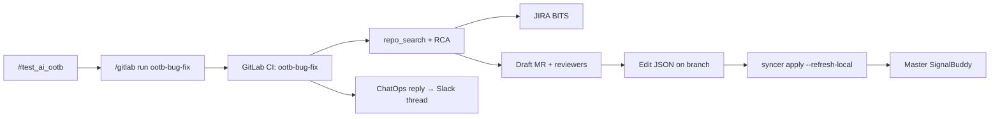

# OOTB Bug-Report Automation

End-to-end workflow for bugs reported in Slack (`#test_ai_ootb` for testing, `#o11y-ootb-content` for production):

1. **Trigger** — `/gitlab run ootb-bug-fix <description>` in Slack (GitLab ChatOps)
2. **Analyze** — heuristic search + automated RCA in repo JSON
3. **Triage** — JIRA ticket (BITS) + **draft** GitLab MR with reviewers
4. **Fix** — edit JSON on the MR branch (manual or agent-assisted)
5. **Sync** — `syncer apply --refresh-local` or CI `sync-signalbuddy` job
6. **Validate & merge** — existing CI ensures `hashCode` changed

**Full setup for `#test_ai_ootb`:** see [SETUP.md](./SETUP.md).

## Architecture



## Configuration

Committed defaults live in `automation/settings.yaml`. Override locally:

```bash
cp automation/config.yaml.example automation/config.yaml
```

`automation/config.yaml` is gitignored — use for team-specific reviewer IDs, not secrets.

## Credentials

| Variable | Used for |
|----------|----------|
| `JIRA_EMAIL` | Atlassian API |
| `JIRA_API_TOKEN` | Atlassian API token |
| `GITLAB_TOKEN` | GitLab PAT (`api` scope) |
| `SIGNALBUDDY_TOKEN` | Master SignalBuddy sync |
| `GITLAB_REVIEWER_IDS` | Override MR reviewers (comma-separated) |
| `SLACK_OWNER_MENTIONS` | Override Slack @mentions |

Set these as GitLab CI/CD variables for ChatOps runs.

## Commands

### Full pipeline (Slack / CI)

```bash
python3 -m automation.bug_pipeline run \
  --input "K8s Node CPU detector fires at 70% instead of 90%" \
  --chatops-reply
```

Reads `CHAT_INPUT` or `OOTB_BUG_INPUT` from the environment when `--input` is omitted.

### Dry-run (search + RCA only)

```bash
python3 -m automation.bug_pipeline run --dry-run \
  --input "K8s Node CPU detector threshold wrong"
```

### Triage only (JIRA + MR)

```bash
python3 -m automation.orchestrator triage \
  --title "Fix K8s Node CPU detector threshold" \
  --description "..." \
  --slack-permalink "https://splunk.slack.com/..." \
  --checkout
```

### SignalBuddy sync

```bash
python3 -m syncer.cli apply --yes --refresh-local
# or
python3 -m automation.orchestrator sync-json --commit
```

## GitLab CI jobs

| Job | Trigger | Purpose |
|-----|---------|---------|
| `ootb-bug-fix` | ChatOps or `OOTB_BUG_INPUT` | Full E2E pipeline |
| `sync-signalbuddy` | Manual on MR | Push JSON to MSB + refresh hashCode |

## Related docs

- [SETUP.md](./SETUP.md) — `#test_ai_ootb` E2E test guide
- `skills/bug-report-workflow/SKILL.md` — agent playbook
- `skills/sync-master-signalbuddy/SKILL.md` — SignalBuddy sync reference
